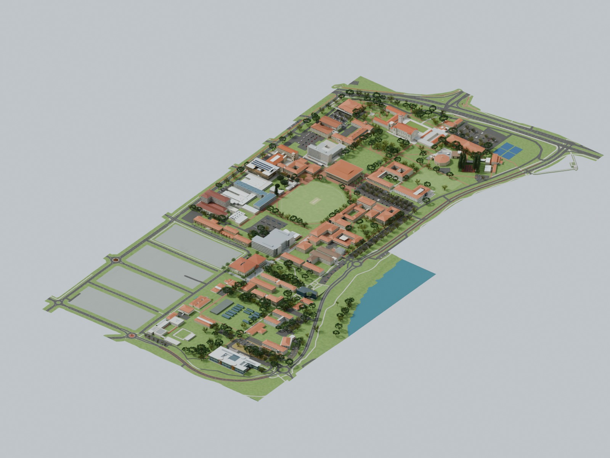
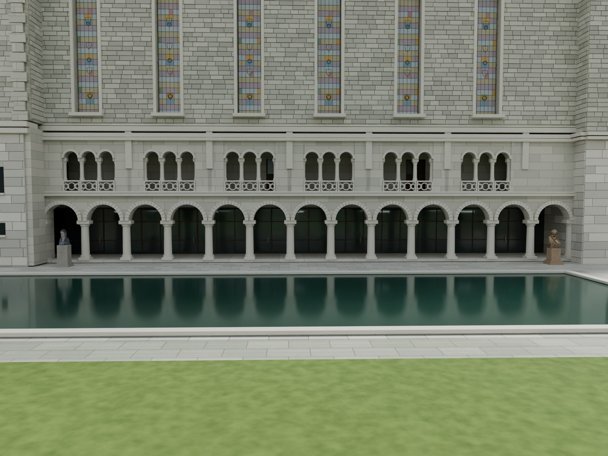
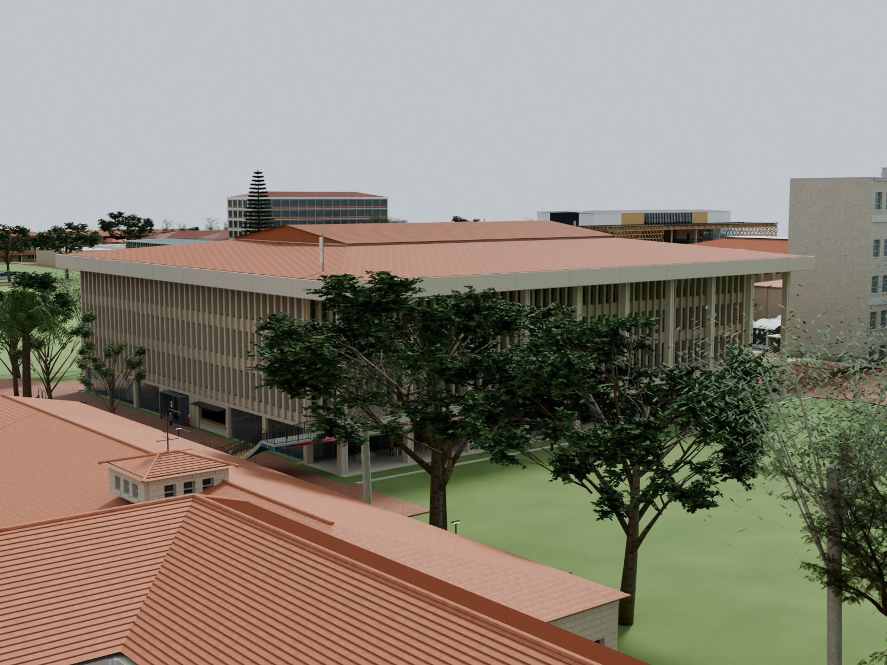
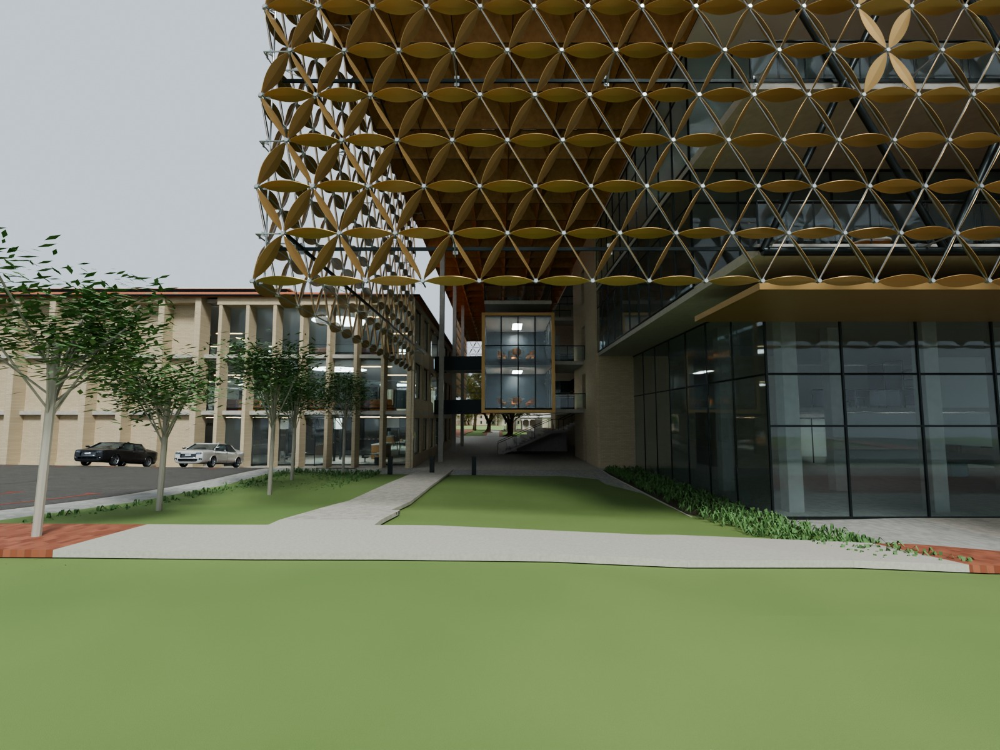
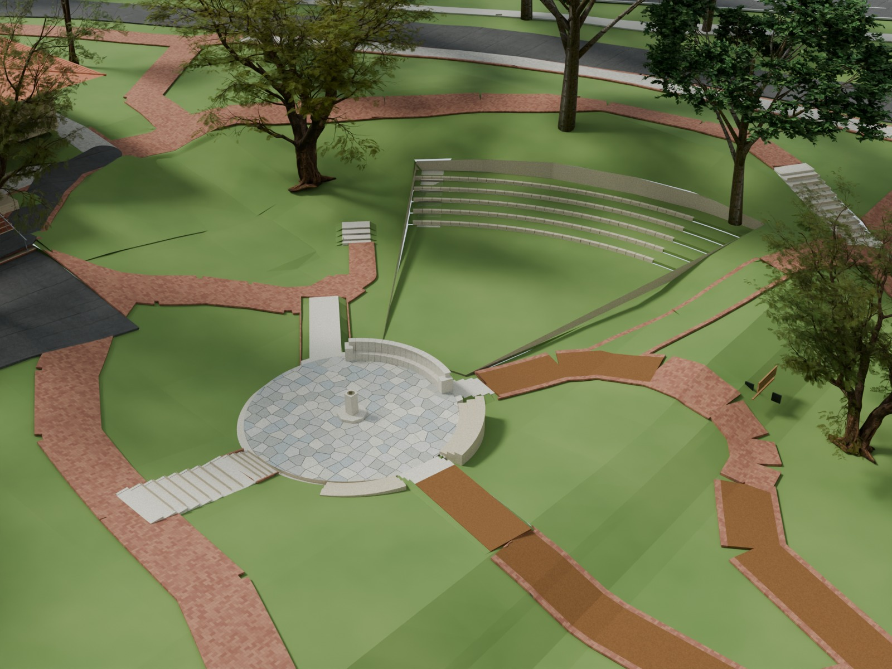
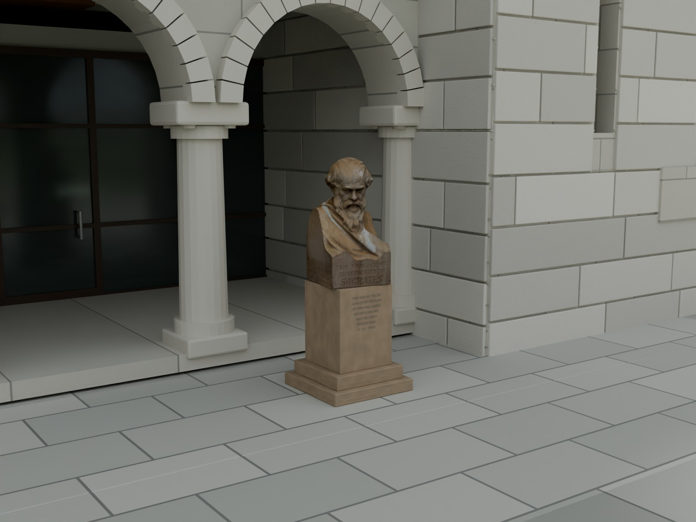
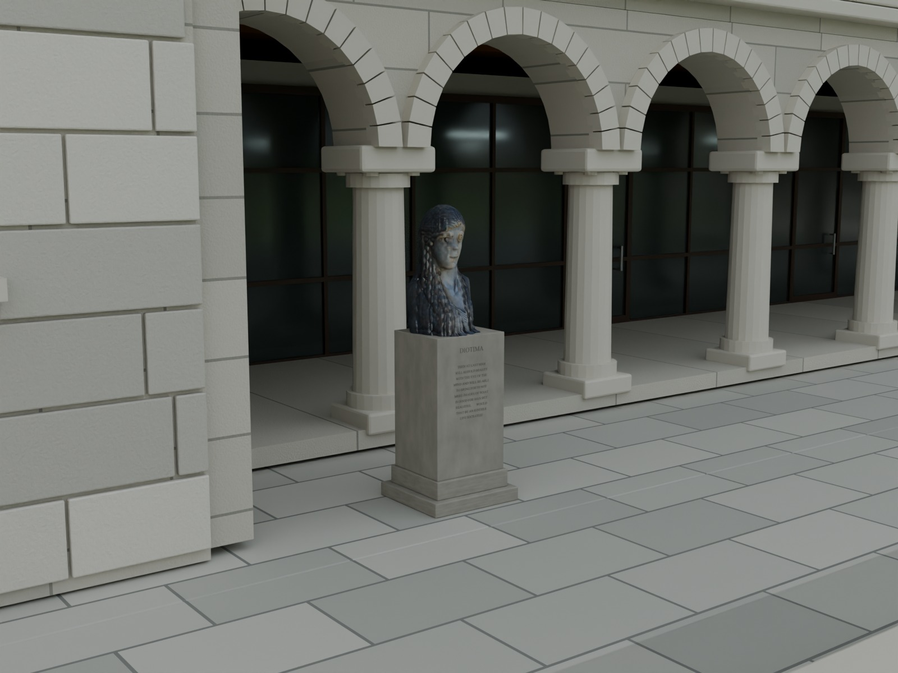
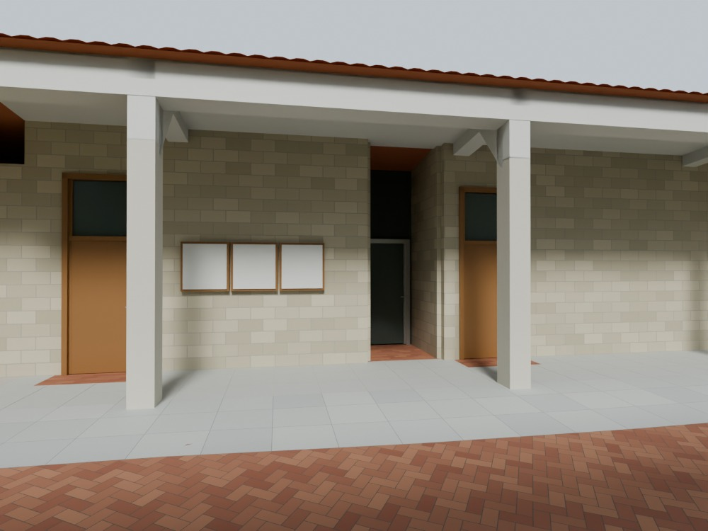
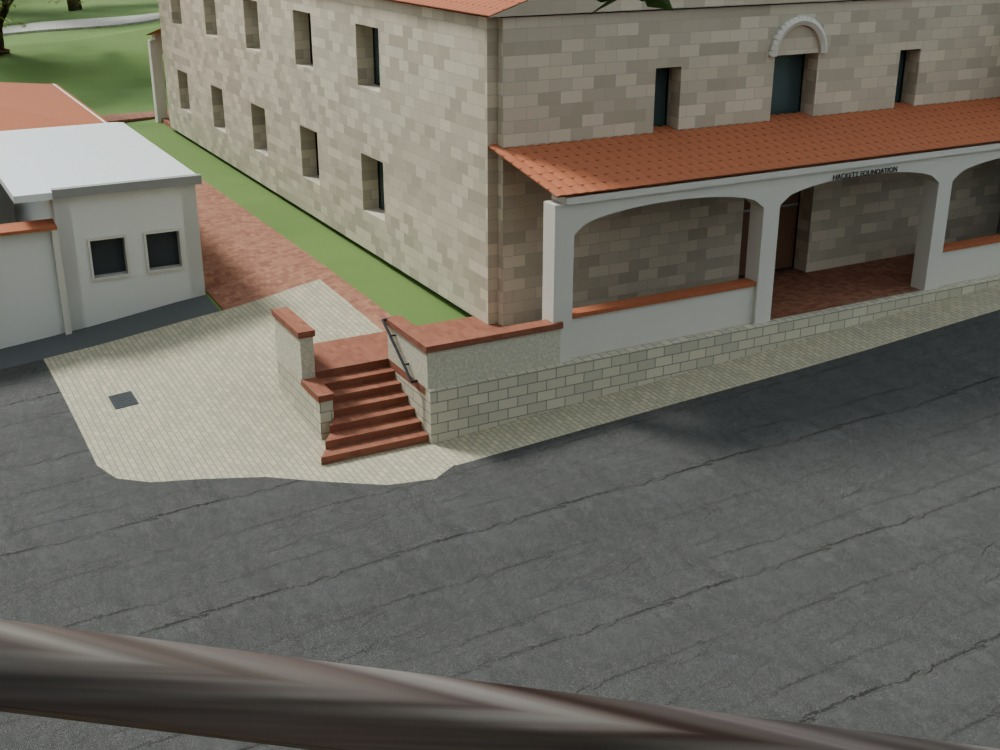
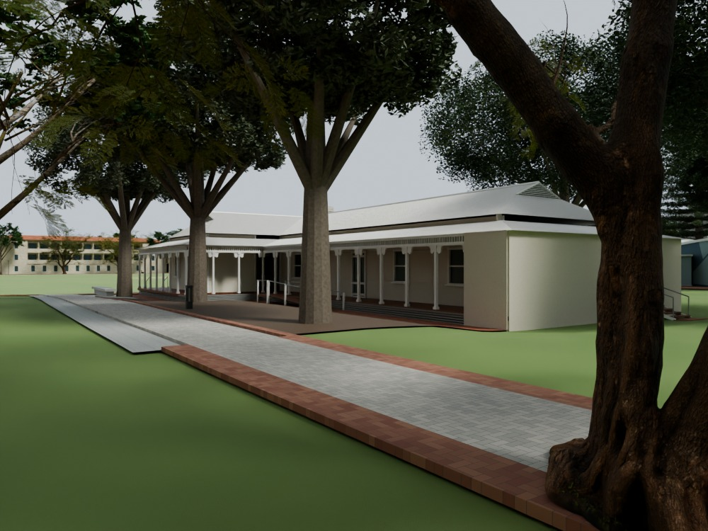

# UWA Campus – Blender model

A campus-wide Blender reconstruction of the University of Western Australia in Perth, covering the Winthrop precinct, Reid Library, EZONE, BJM, neighbouring academic buildings, gardens, paths and parking areas. This release is based on **Revision 25**, including the merged Music, Hackett and Irwin improvements.

> This is a photo-guided interpretive model. Detail and confidence vary across the campus; it is not a measured survey or a claim that every audit item is complete. See [accuracy and limitations](sources_and_licenses/ACCURACY.md).

## Download

Download **[UWA_Campus_Blender.zip](https://github.com/feiyaocai88-bit/uwa-campus-blender/releases/download/blender-scene/UWA_Campus_Blender.zip)** (**726.6 MB / 692.9 MiB**) from the **[Blender scene release](https://github.com/feiyaocai88-bit/uwa-campus-blender/releases/tag/blender-scene)**. A SHA-256 checksum accompanies the download.

The ZIP contains `UWA_Campus.blend`, source credits, scope notes, utility scripts and validation records. The `.blend` is distributed through Releases because of its size; GitHub's **Code → Download ZIP** contains the repository documentation and scripts, not the model.

Open `UWA_Campus.blend` in **Blender 5.2 LTS**; the release was checked with **5.2.3 LTS**. Textures and the BJM, EZONE and Winthrop building libraries are packed into the file. No Blender MCP connection or add-on is needed to open it. The default camera shows a campus overview. Press **Numpad 0** for the camera view, or choose one of the named review cameras in Scene Properties.

Coordinates use **X east, Y north, Z up**, in metres. The file is a substantial scene with tens of thousands of objects; allow time for the packed libraries to load. System-font inscriptions are preserved as meshes in the release copy.

## Gallery

All images below are renders from the model. The campus and building views were rendered from the publication copy; the final three patch views are the original R25 review renders.

### Buildings and landscape

| Winthrop arcade and reflecting pool | Reid Library |
| --- | --- |
|  |  |

| EZONE west approach | Sunken Garden |
| --- | --- |
|  |  |

### Winthrop sculptures

| Socrates — adapted scan and reconstructed base | Diotima — approximate photo reconstruction |
| --- | --- |
|  |  |

Socrates uses the credited free scan; Diotima uses a single photograph and inferred geometry. The latter is not an authentic scan. Authors, modifications and component licences are recorded in [CREDITS.md](sources_and_licenses/CREDITS.md).

### Revision 25 improvements

| Music entrances | Hackett forecourt |
| --- | --- |
|  |  |

## What is modelled

- **Major architecture:** Winthrop Hall, clock tower, gateway and adjoining wings; Reid Library; EZONE and EECE; BJM; and photograph-guided surrounding academic and service buildings.
- **Selected interiors:** developed rooms and circulation in Reid, EZONE/EECE, Winthrop and BJM. Other buildings vary from exterior models with floors to partial interior arrangements.
- **Campus landscape:** the Sunken Garden and courts, Somerville, paths and stairs, parking, mapped roads, interpolated terrain, planting, furniture and vehicle instances.
- **Artwork and sculpture:** Socrates and Diotima, Ceres, the Geology panel, orbicular granite fountain, ENCM corner and a simplified Reid bridge mural.
- **Accumulated local revisions:** entrances and ground connections around Bayliss, Tattersall, Shenton, Mathematics, Geology, University Club, New Fortune, Monadelphous and other locations.
- **R25 merged patches:** Music's confirmed entrances and teaching-room frontage; Hackett's forecourt paving, seven steps, walls, handrails and drainage; Irwin's west entrance, additional stair, north ramp, existing access connections and selected 2024 interior finishes.

## Automatic checks

The original R25 validation records **17 Music checks, 17 Hackett checks, 17 Irwin west/interior checks and 11 Irwin access checks**, all passing, with earlier R24 checks retained. A compact, traceable summary is in [revision25_check_summary.json](validation/revision25_check_summary.json). These are scoped historical checks, not a new comprehensive survey of every campus object.

The publication file is reopened separately with [validate_release.py](scripts/validate_release.py). It checks the packed image and library dependencies, required collections, scene size, overview camera and font portability. Results are in [publication_validation.json](validation/publication_validation.json). The release records also identify the source file and publication changes.

To render or inspect the scene from a terminal, follow [scripts/README.md](scripts/README.md). The supplied scripts are utilities for the completed model, not a complete build-from-scratch pipeline.

## Accuracy and limitations

Photographs and OSM outlines guide the reconstruction. Building heights, concealed facades, some roof equipment, rooms, terrain transitions and planting are estimated. Detail is uneven between buildings. The model combines references from several dates and does not represent a campus-wide survey at a single date.

Single-view sculpture reconstruction and photograph-based shallow relief cannot establish accurate hidden geometry. Terrain comes from a 5 m DEM with interpolation and local grading. Modelled ramps and clearances are not accessibility certification. See [ACCURACY.md](sources_and_licenses/ACCURACY.md) for the specific limitations.

## Repository contents

| Path | Contents |
| --- | --- |
| [`images/`](images) | Campus, building, sculpture and patch previews |
| [`scripts/`](scripts) | Blender scene validation and gallery rendering utilities |
| [`sources_and_licenses/`](sources_and_licenses) | Credits, component licences, public reference links and accuracy notes |
| [`validation/`](validation) | Historical check summary, publication validation and release manifest |
| [Releases](https://github.com/feiyaocai88-bit/uwa-campus-blender/releases) | Downloadable Blender model package and checksums |

## Credits and licences

The model contains components under different licences. It includes the Socrates scan by **jane-heloise**, repaired by **3DWP** (CC BY 4.0); a Diotima adaptation based on **Pauldavidbourke**'s photograph (CC BY-SA 4.0); credited Commons artwork photographs; **Poly Haven** vegetation and materials and **Innerscene** cars (CC0); **OpenStreetMap contributors**' geographic data (ODbL); and **Geoscience Australia** elevation data (CC BY 4.0).

Full attribution, source URLs, changes and licence links are in **[CREDITS.md](sources_and_licenses/CREDITS.md)** and accompany the model download. Share-alike adaptations are identified there. The repository does not apply one blanket licence to unrelated third-party components. Reference screenshots and private audit documents are not distributed. This is an independent project, not an official UWA model.
